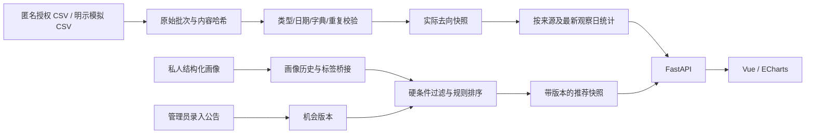

# 第一阶段工程设计与后续任务

2026年10月13日更新：V0.2 已实现私人问卷与七角色、辅助决策、外部问卷接入、固定衡阳来源采集和六种可视化，参见 [功能指南](FEATURES_V2.md)。下面的第一阶段结构保留作设计背景；角色和固定来源采集不再属于纯文档设计。完整数仓与模型实验仍需后续完成。

用户确认以附件方案为基础，数据库改为本地 MySQL。本工程从空仓库重新实现；没有获得旧工程压缩包，也没有读取引用聊天的正文。

## 已运行的链路

## 实际表结构

| 表 | 用途 |
| --- | --- |
| app_user / login_session | 账户、密码散列、可撤销限时会话；数据库不保存原始访问令牌 |
| dim_student_profile / bridge_profile_tag | SCD2 画像有效期与多技能/城市/意向 |
| ingestion_batch | ODS 原始 CSV、内容哈希、来源、清洗版本与质量结果 |
| fact_outcome_snapshot | 按匿名学生与观察日的实际去向明细 |
| fact_opportunity_snapshot | 机会内容版本及结构化条件 |
| fact_recommendation_exposure | 当时画像版本、机会快照和规则结果 |
| experience_post | 公开昵称、授权、审核、撤回状态 |
| audit_event | 管理操作记录 |

当前共享字典在代码中显式维护；机会不同路径的条件仍在基础表内，尚未拆分路径专属详情。看板对明细做实时小规模聚合，**没有实现完整星型仓库、DWS/ADS 或物化视图**。不应在论文中将尚未实现的层和实验写为已完成。

MySQL 迁移由 Alembic 管理，第一版固定迁移 `0001`，原始内容扩容为 `0002`。新功能应生成新迁移，不修改已使用的历史迁移；检查：`python -m alembic check`。

## 本地运行边界

默认后端与前端只绑定 `127.0.0.1`。数据库密码由本机 `.env` 读取，使用 SQLAlchemy URL 对象传入驱动，不在代码中拼接或展示。前端使用同源 `/api` 代理。端口与服务进程不应被假定在云环境发布后继续存活。

生产使用前需要新增 HTTPS、登录节流、学校核验或邀请码流程、备份、权限细分、身份授权管理、删除申请、跨查询隐私保护以及发布部署配置。当前公开演示账户只用于本机演示。

## 后续实施顺序

1. 收集两个来源各10条真实公告，人工核对字段；依公开访问规则编写来源专属采集器，保留 HTML/PDF 原始版本。
2. 获得学校授权或校友自愿样本；建立身份映射隔离、撤回与删除流程，不能用模拟数据声称真实推荐效果。
3. 加入来源、城市、专业、日期、路径、技能共享维表和报告汇总事实；分别定义样本分母、口径版本，补 DWS/ADS 刷新。
4. 在相同资格过滤和候选集合上实现 TF-IDF 对照，按用户/时间划分标注数据，测 Precision@5、NDCG@5 与候选覆盖率。
5. 保存可复现实验文件；验证历史画像与机会版本，再比较查询结果一致性及 P50/P95。根据数据规模决定是否引入 PySpark。
6. 有真实评估数据后完善学校指标、校友匹配、评论/举报等扩展，不为页面数而增加无证据统计。

需要用户本地完成的事是安装工具、输入自己的 MySQL 凭据并执行启动脚本；无需提供额外 API 密钥或云服务账户。
