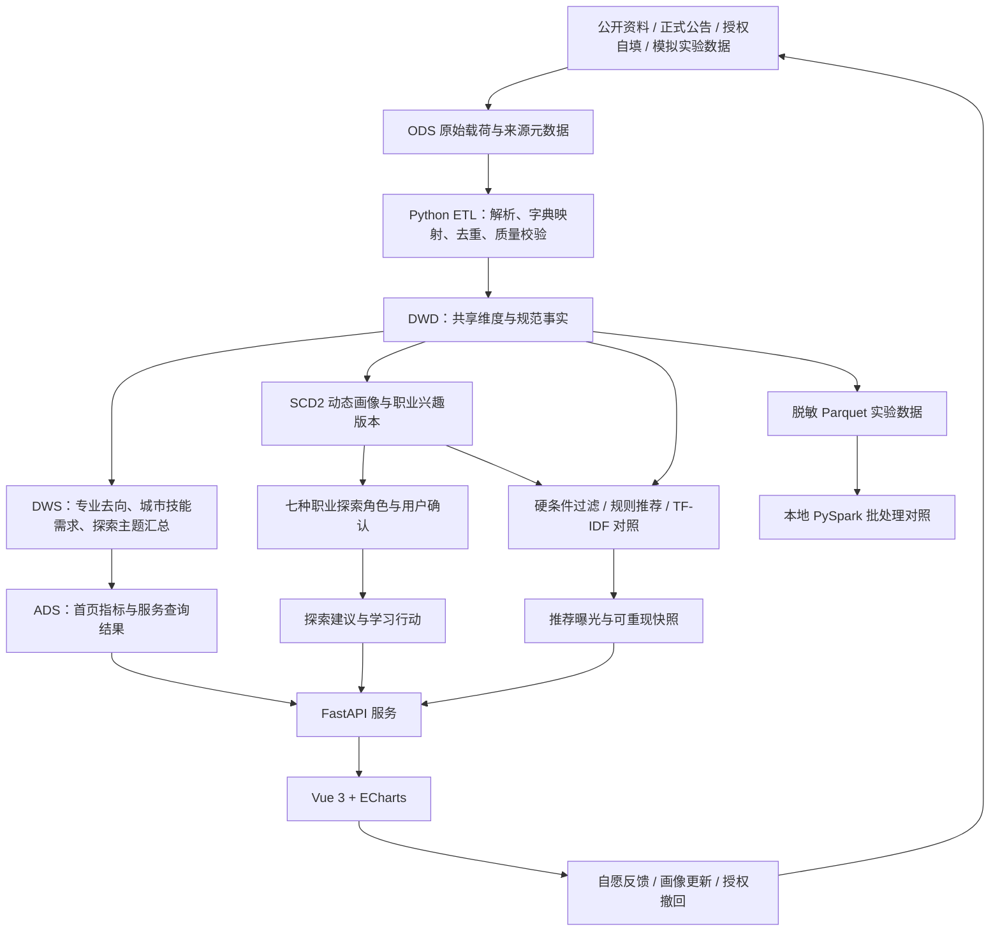

# 基于多源数据仓库与动态职业画像的大学生职业发展辅助决策平台设计与实现

## 项目技术实施方案与职业探索角色设计

| 项目项 | 内容 |
| --- | --- |
| 项目名称 | 知途——学生职业发展辅助决策平台 |
| 应用对象 | 湖南交通工程学院学生；首期聚焦数据科学与大数据技术专业 |
| 文档版本 | V2.0 |
| 编制日期 | 2026年10月12日 |
| 主要运行环境 | 本地 Windows、Python 3.12、Node.js 24 LTS、MySQL 8.0/8.4 |
| 基础工程 | Vue 3、Vite、ECharts、FastAPI、SQLAlchemy、Alembic |
| 新增设计 | 基于职业兴趣与探索状态的七种可爱角色、可解释标签、画像与推荐版本追溯 |

## 摘要

本项目针对大学生职业信息来源分散、历史去向口径不一致、个人发展意向变化难以追踪以及推荐解释不足等问题，设计并实现学生职业发展辅助决策平台。平台以公开资料、正式机会公告和经过授权的学生自填数据为来源，通过原始数据留存、标准字典、质量校验、分层数据仓库和动态画像，为学生提供同专业去向分析、多路径机会检索、技能差距说明和可追溯的推荐结果。

系统采用本地 MySQL 作为业务与分析数据的主要存储，利用 Python 完成小规模 ETL，逐步补充 Parquet 与 PySpark 批处理实验，以 ECharts 展示多维统计。数据量较小时优先保证数据正确性和开发可行性；分布式技术的价值通过独立规模实验验证，不预设实际学校数据已达到“大数据”规模。

在动态职业画像基础上，引入职业兴趣理论、社会认知职业理论及生涯适应力的设计思路，以七种原创动物角色呈现学生当前的兴趣倾向和探索状态。角色允许并存、变化和用户修正，不作为固定人格、岗位资格或就业能力等级。平台用角色提高信息理解和探索意愿，最终决定仍由学生依据兴趣、条件、资源和现实机会作出。

**关键词：** 多源数据治理；数据仓库；ETL；SCD2；职业兴趣；可解释推荐；PySpark；数据可视化。

## 一、研究目标与业务边界

### 1.1 研究目标

1. 建立统一、可追溯的数据链路，回答“数据来自哪里、如何清洗、指标如何计算”。
2. 建立动态画像与历史快照，回答“学生在某一时间的兴趣、技能和意向是什么”。
3. 实现分路径、可解释的机会推荐，回答“为何展示该机会、信息是否完整、尚需核对哪些条件”。
4. 设计亲和的职业探索角色，验证其是否帮助学生理解画像和制定行动，而非仅增加页面装饰。
5. 通过数据质量、推荐对照、历史一致性和查询性能实验，形成可以复现的毕业设计证据。

### 1.2 首期范围

首期以一个专业、2—3个毕业届次、湖南及周边城市的公开发展机会为研究范围。支持企业就业、升学、公务员、事业单位和实习五类机会；用户可以同时准备多个方向。真实样本量由授权与回收情况决定，不承诺全校完整覆盖。

平台提供辅助参考，不生成唯一“最适合的人生路径”、录用概率或上岸概率。公开报告汇总数据、授权逐人样本和模拟数据分别管理；不能将报告百分比转换成虚构个人记录。

### 1.3 已实现与规划的区别

| 内容 | 当前状态 | 本方案后续工作 |
| --- | --- | --- |
| 本地业务服务与前端 | 已有 FastAPI/Vue 工程，支持 MySQL；用户电脑上的 MySQL 服务及端口已确认可用 | 完成本地启动与功能验收，持续维护 |
| 动态画像 | 已有画像版本、有效期、技能/城市/意向桥接和并发版本检查 | 接入职业兴趣问卷及角色版本 |
| 数据治理 | 已有匿名去向 CSV 导入、原始批次、哈希、质量报告和重复处理 | 增加公告解析、报告指标、正式字典和增量任务 |
| 看板 | 已有来源、专业、届次筛选及去向/城市/届次样本图表 | 增加仓库聚合表与指标血缘 |
| 机会推荐 | 已有技能、城市、专业的规则排序及推荐历史快照 | 增加 TF-IDF 对照和受控的兴趣辅助排序 |
| 职业角色 | 本文完成设计，不在现有页面中自动生效 | 新增问卷、角色计算、用户确认、表情包资源与界面 |
| 完整数仓和 PySpark | 尚未实现、尚未验证 | 按本文分阶段建设并单独记录实验 |
| 真实学校数据与模型效果 | 尚未取得完整真实样本，未开展真实推荐效果实验 | 获得授权后进行人工核验与评价 |

已有工程在此前云验证中通过22项后端测试（分别运行于 SQLite 和 MySQL 8.4）、2项 Chromium 操作测试及前端生产构建。该证据说明已有工程的功能链路可运行，不能作为新增角色模块、完整数仓或真实推荐有效性的验证结果。详见 [验证记录](VALIDATION.md)。

## 二、总体技术架构

### 2.1 架构原则

采用“本地运行、统一存储、分层治理、可解释建模、按需扩展”的路线。一个本地 MySQL 实例承载业务事务与分析表，以表名、权限和任务边界组织逻辑层；原始文件和实验 Parquet 保存在受控本地目录。不为层数安装多套服务。



图中的完整 DWS、ADS、兴趣与角色模块、TF-IDF 和 PySpark 均为目标架构；不能把目标图直接当作当前实现图。

### 2.2 技术选型

| 层次 | 技术 | 具体职责 | 实施级别 |
| --- | --- | --- | --- |
| 交互界面 | Vue 3、Vue Router、Vite | 表单、角色卡片、路径切换、历史版本和权限导航 | 基础必需 |
| 可视化 | ECharts | 去向、城市、技能需求、兴趣维度与时间变化 | 基础必需 |
| API | FastAPI、Pydantic | 字段校验、权限、画像与推荐接口 | 基础必需 |
| 关系存储 | MySQL 8.0/8.4、SQLAlchemy | 业务事务、维度/事实、分析汇总表 | 基础必需 |
| 迁移 | Alembic | 新模块的可追溯表结构升级 | 基础必需 |
| 小规模 ETL | Python、CSV、SQL；按需 pandas | 清洗、质量报告、幂等加载和聚合 | 基础必需 |
| 文本处理 | 标准技能词典、分词、scikit-learn | TF-IDF 与余弦相似度对照 | 实验阶段补充 |
| 列式文件 | Parquet | 脱敏批处理输入、分区存储、实验复用 | 数据工程实验 |
| 批处理 | PySpark 4.0.x、Java 17及兼容 Python | 多规模去重、聚合、Parquet 读写实验 | 独立扩展，需实际验证版本组合 |
| 任务调度 | 手工 CLI 起步，后续 Windows 任务计划或简单调度器 | 定期采集、质量校验和汇总刷新 | 按阶段加入 |
| 测试 | pytest、Playwright | 业务约束、历史一致性、角色规则与界面流程 | 必需 |

主应用继续运行在 Windows 本机。PySpark 实验可在本机 WSL2/Linux 环境执行，固定线程数和内存；不要求购买云服务。Kafka、Flink、Hadoop 集群和深度模型在现阶段不列为必需组件。

## 三、大数据技术点与可验收成果

| 技术点 | 项目应用 | 需要提交的证据 |
| --- | --- | --- |
| 多源异构数据集成 | HTML/PDF/CSV/表单分别解析，统一专业、城市、路径和技能字典 | 来源登记、解析样例、字段映射、批次与失败记录 |
| ETL与数据治理 | 原始留存、格式校验、缺失管理、业务校验、去重、增量入库 | 清洗版本、质量报告、拒绝样例、重复任务测试 |
| 分层数据仓库 | ODS→DWD→DWS→ADS；分开报告汇总与逐人事实 | 模型图、表粒度、加载任务、血缘与一致性检查 |
| 维度建模与多维分析 | 共享专业、城市、日期、路径维度；多值属性使用桥接表 | 切片/钻取结果、分母定义、防多值连接重复计数验证 |
| SCD2与时间建模 | 保留技能、意向、兴趣和角色变化，不覆盖历史 | 有效期、版本关联、当时推荐复现用例 |
| 内容挖掘与可解释推荐 | 技能归一、规则基线、TF-IDF 对照、兴趣辅助解释 | 同候选集结果、理由、差距、Precision@5/NDCG@5 |
| Parquet与批处理 | 模拟多规模数据的分区导出、Spark 去重和聚合 | 代码、硬件/分区配置、结果一致性、耗时与内存 |
| OLAP查询优化 | 用仓库事实与汇总表支持高频专业/届次查询 | SQL、索引、EXPLAIN、P50/P95、刷新成本 |
| 大数据可视化 | 有来源、样本量和口径的图表及兴趣角色解释 | 页面截图、交互验证、空数据/缺失值展示 |
| 数据安全与权限 | 授权、匿名标识、私人问卷、访问审计和撤回 | 权限测试、匿名处理说明、删除与重算流程 |

网页开发、登录功能和数据库连接是系统基础，不能单独替代大数据技术成果。大数据部分应体现数据集成、仓库建模、可复现的分析和规模实验，而非仅列出框架名称。

## 四、数据来源、采集与质量治理

### 4.1 来源及用途

| 数据对象 | 来源候选 | 粒度 | 使用方式 |
| --- | --- | --- | --- |
| 学校概况、专业目录 | [学校官网](https://hnjt.edu.cn/)及正式教学质量报告 | 学校/专业/年份指标 | 人工核验来源、分母和年份后录入 |
| 企业与实习机会 | 企业官网、学校招聘公告、[国家大学生就业服务平台](https://www.ncss.cn/) | 一条机会的一个版本 | 按公开访问规则采集，保留原文和截止日期 |
| 升学机会 | [研招网](https://yz.chsi.com.cn/)及高校研究生招生官网 | 一个项目/专业的招生版本 | 提取专业、科目、条件和原文；缺项标待核对 |
| 公务员与事业单位机会 | 湖南人社、正式招考公告及职位附件 | 一个批次中的一个职位 | 对专业目录和资格要求人工复核 |
| 学生职业画像 | 自愿填写的简历、兴趣问卷、偏好表单 | 一位学生的一个画像/问卷版本 | 默认私人；用途授权与公开经验授权分开 |
| 校友实际去向 | 校友自填或学校授权匿名数据 | 一名匿名毕业生在一个观察日的主要去向 | 区分自报与学校确认，不用备考意向代替实际结果 |
| 规模实验数据 | 明确标记的合成数据 | 实验记录 | 只验证功能、约束与性能，不评价真实职业选择 |

上述入口是来源设计，不表示本方案已取得所有网站数据、接口或授权。采集器应记录访问规则和版本，不绕过登录或访问限制。

### 4.2 原始留存与血缘

每份文档或任务至少记录：`source_id`、`source_url`、`source_record_id`、`published_at`、`fetched_at`、`content_hash`、`batch_id`、`parser_version`、`cleaning_version`、`data_kind`、`authorization_scope`。同一文件更新时保留版本，指标能追溯到原文、批次和清洗规则。

缺失发布日期保持未知；不能用抓取日期代替发布日期。图片/OCR或 PDF 表格需抽样人工核对列、单位、百分号与页码。

### 4.3 ETL流程

1. **抽取：** 来源专属解析器获取公开文件，先保存原始载荷，再生成候选记录。
2. **规范化：** 通过正式维度和别名字典映射城市、专业、技能、路径；不依名称相似就合并专业。
3. **格式校验：** 检查类型、日期、长度、枚举、来源和单位。
4. **业务校验：** 实习不能当毕业最终去向，未来届次不能生成当前已毕业事实，授权范围必须符合用途。
5. **去重与冲突：** 使用业务键和版本判断；一致重复跳过，冲突进入待审区，不能静默覆盖。
6. **加载：** 事务写入规范事实；仅对受影响分组刷新汇总，记录水位和运行结果。
7. **质量报告：** 输出接受、拒绝、重复、完整率和人工抽检结果，不只显示“清洗成功”。

### 4.4 指标口径

完整率等于“非空有效字段数/应检查字段数”；校验通过率等于“通过字段与业务规则的记录数/输入记录数”，需说明一致重复是否计入；重复率等于“一致重复数/输入记录数”。解析正确率需将抽样结果与人工标准答案比较，不能用格式校验通过率代替。

工资按月薪/年薪、范围、税前/税后和面议分别管理。未填写英语能力、实习或城市表示未知，不转为0或“没有能力”。

## 五、业务数据库与分析仓库设计

### 5.1 分类维度分离

| 维度 | 例子 | 约束 |
| --- | --- | --- |
| 当前阶段 | 在校、准备实习、求职、备考、已毕业 | 表示状态，不等于最终去向 |
| 发展意向 | 企业就业、升学、公务员、事业单位、实习 | 可多选 |
| 单位性质 | 民企、国企、政府机关、事业单位、高校 | 与路径分别编码 |
| 实际去向 | 企业就业、升学、公务员、事业单位、待落实、其他 | 同一来源和观察日按约定记录一个主要去向 |
| 目的城市 | 工作或升学院校所在地 | 可未知；本人偏好城市另表管理 |
| 职业兴趣 | R、I、A、S、E、C 六个活动兴趣维度 | 连续向量，可有多个较高维度 |
| 角色与探索状态 | 主角色、辅助角色、探索中、信息不足 | 是展示与指导层，不替代上述业务分类 |

### 5.2 目标仓库分层

| 层 | 主要内容 | 粒度与任务 |
| --- | --- | --- |
| ODS | 原始文档、原始问卷、自填载荷、任务与质量元数据 | 一个来源对象的一个版本；原始内容受权限控制 |
| DWD | 规范去向、机会版本、兴趣测量、SCD2画像、共享维度 | 保留稳定业务键、时间和来源；避免混淆粒度 |
| DWS | 专业去向分布、城市技能需求、届次样本、兴趣探索主题 | 按来源、观察日、专业、届次等聚合 |
| ADS | 首页指标、机会检索摘要、角色解释卡、推荐结果 | 面向已定义的页面查询与服务 |

MySQL 普通视图没有自动物化刷新机制。DWS/ADS建议使用具有唯一键的汇总表和显式刷新任务，记录刷新时间、数据水位和失败状态；先做可重复的全量刷新，再按需要改为增量。写入时在事务中替换受影响分组，避免刷新中途显示混合版本。

### 5.3 表设计与粒度

下表列出的扩展表是设计目标，需要新建 Alembic 迁移及加载任务后才能作为实际实现报告。

| 表/实体 | 粒度或主键约束 | 关键字段 |
| --- | --- | --- |
| `app_user` / `login_session` | 用户、会话 | 角色、密码散列、令牌哈希、过期时间 |
| `ods_raw_document` / `ingestion_batch` | 文档版本、导入批次 | 来源、载荷、哈希、解析/清洗版本、授权、质量 |
| `dim_major` / `dim_city` / `dim_path` / `dim_skill` / `dim_source` / `dim_date` | 一个标准维度成员 | 代理键、标准编码、定义及版本 |
| `dim_student_profile` | `(student_key, profile_version)` | 有效期、记录时间、学历/阶段等属性 |
| `bridge_profile_skill/city/intent` | 一个画像与一个多值属性 | 属性键、证据来源、映射版本 |
| `fact_outcome_snapshot` | `(source_id, student_key, observed_on)` | 专业、届次、主要去向、城市、确认状态、批次 |
| `fact_report_metric` | 报告、年份、范围、指标、定义版本 | 值、单位、分母、原文页码；独立于逐人事实 |
| `fact_opportunity_snapshot` | `(source_id, source_record_id, opportunity_version)` | 路径、条件、发布时间、有效期、来源 |
| `interest_instrument` / `interest_item` | 问卷版本、题目版本 | 维度、文本、计分方向、用途说明 |
| `interest_response` / `fact_interest_measurement` | 学生、测量批次、题目/维度 | 原始选项、缺失、覆盖率、维度分、测量时间 |
| `profile_role_snapshot` | 画像、问卷、规则版本的一次角色计算 | 主/辅助角色、探索状态、理由、用户确认 |
| `fact_recommendation_exposure` / `fact_interaction` | 一次推荐曝光、一次交互事件 | 画像/机会/模型版本、排名、发生时间、反馈类型 |
| `dws_major_outcome` | 来源、截至日、专业、届次、去向 | 分组人数、分母定义、水位 |
| `dws_city_skill_demand` | 来源、时间窗、城市、技能 | 去重机会数、要求次数、统计范围 |
| `ads_dashboard_metric` | 已登记的指标及查询范围 | 展示值、来源、水位、口径版本 |

技能、城市、意向均为多值属性，直接将多个桥接表一起连接会放大行数。先按事实粒度去重或分别聚合，再连接展示；不得将连接行数当学生人数。

### 5.4 时间一致性与去重

画像有效区间采用 `[valid_from, valid_to)`，当前版本的 `valid_to` 为空，另外记录 `recorded_at`。既有工程是有效期加记录时间的 SCD2 设计，尚不等于完整的双时态数据库；涉及历史补录和时间纠错时，应另外定义事件时间与系统时间的处理规则。

推荐必须引用当时的画像、问卷、角色规则、机会和模型版本。更改技能或兴趣产生新画像；更改公告产生新机会版本；更改题目、权重或标签条件须提升对应版本，不能悄悄重写旧记录。

统计先在一个来源内，取截至观察日每位匿名毕业生的最新事实，再按专业/届次分组。不同来源可能包含同一人，不能直接合并人数；没有可靠授权映射时分别展示。意向与结果属于不同事实，不能把“准备考研”算成“已经升学”。

### 5.5 查询优化

围绕 `source_id + data_kind + observed_on`、专业/届次组合和机会来源业务键建立索引；使用 MySQL 8 的窗口函数选择最新快照，结合 EXPLAIN 检查实际执行计划。高频图表优先查询 DWS/ADS，带出水位与口径。

实验分别比较业务多表查询、仓库事实查询和汇总表查询；先检查结果完全一致，再比较耗时和空间。分区应在数据量与执行计划支持时引入，并检查 MySQL 对分区表唯一键的限制，不在第一阶段无条件分区。

## 六、职业心理学依据与画像原则

### 6.1 理论的具体用途

| 理论 | 本项目借鉴内容 | 可支持的设计 | 不能据此得出的结论 |
| --- | --- | --- | --- |
| Holland职业兴趣理论（RIASEC） | 现实/实干、研究、艺术、社会、企业/开拓、常规/秩序六类活动兴趣 | 描述学生更喜欢哪些职业活动，提供可探索任务 | 不保证某专业、人格或职业成功；不是六种互斥的人 |
| 社会认知职业理论（SCCT） | 任务相关自我效能、结果期待、目标及环境支持/障碍 | 将“喜欢做什么”“觉得能做什么”“现实条件”分开；给可完成的小任务 | 不能从兴趣分直接推断能力或失败风险 |
| 生涯适应力研究 | 关注、控制、好奇、自信等适应资源 | 引导了解未来、参与决策、试探选项、积累经验 | 自编问题不能直接称为已验证的标准生涯适应力量表 |
| 自我决定理论 | 自主、胜任、关系需要 | 用户可改标签、可隐藏；任务难度合理；用支持性表达 | 不能用标签迫使学生选路或制造连续打卡压力 |

角色只是对连续兴趣及探索状态的亲和表达。六类理论维度加一个产品探索状态，形成七种展示形象；**第七类不是心理学发现的新人格类型**。

### 6.2 当前画像需要补什么

现有画像只有专业、学历/阶段、技能、英语、实习、城市、意向和经历文本。拥有 Python 技能可能源于必修课，并不表示学生偏爱研究；选择考公也可能来自家庭、地域或资源约束，并不证明某种兴趣。因此不能仅按简历字段自动宣称完成了心理学分类。

建议新增四组自愿信息，分别保存：

1. **职业活动兴趣：** 我喜欢做哪些任务。
2. **任务自我效能：** 对完成某项具体任务的当前信心；与实际技能证据分开。
3. **工作价值与现实条件：** 城市、收入信息需求、稳定性、学习投入、时间和资源支持；允许不答。
4. **探索与行动状态：** 是否了解选项、是否做过体验、希望下一步获得什么帮助。

不从简历、表情、发帖语言或点击记录推断精神健康、家庭背景或固定性格。兴趣角色用于自我探索，默认本人可见，不向招聘方提供“学生类型评分”。

### 6.3 表述规则

推荐用语为“你最近更喜欢分析与验证类任务”“也可以看看另一个方向”“这份标签可以修改”。标签不使用“低能力”“不适合就业”“社恐”“卷王”“躺平”等等级化或贬损表述。无需与他人比较名次，兴趣低分只表示较少选择该类活动，不表示能力差。

## 七、七种可爱角色与表情包设计

### 7.1 角色总表

| 角色/代号 | 对应维度或状态 | 特殊标签 | 当前偏好描述 | 建议探索活动 | 可爱的形象与台词 |
| --- | --- | --- | --- | --- | --- |
| 🦝 实干小浣熊 `R` | Realistic，实干活动兴趣 | 动手实践、搭建验证 | 更喜欢操作工具、搭建可用成果和解决实际问题 | 做一次小型采集/ETL、部署本地应用、复现设备或系统排错；可了解工程实施与开发实践 | 薄荷绿围裙、迷你工具箱，举起拼好的零件：“先做一个小成果！” |
| 🦉 研究小猫头鹰 `I` | Investigative，研究活动兴趣 | 追问原因、分析验证 | 更喜欢研究原因、比较解释、分析数据和验证假设 | 阅读一篇方法资料、完成一个数据分析实验、了解研究生项目与岗位研究任务 | 奶油色圆眼镜、蓝色笔记本，头顶小灯泡：“让我再验证一下！” |
| 🦊 创意小狐狸 `A` | Artistic，创作活动兴趣 | 创意表达、多种可能 | 更喜欢设计表达、构思作品和尝试不同呈现方式 | 制作一张数据故事图、设计交互原型、建立作品集；可了解可视化与产品设计任务 | 桃橙色围巾、画笔、星星尾巴装饰：“这个想法值得试试！” |
| 🐶 协作小金毛 `S` | Social，助人活动兴趣 | 支持他人、共同成长 | 更喜欢教学、支持、服务以及帮助他人解决问题 | 做一次同伴讲解、参加志愿/助教体验、了解用户支持与教学服务任务 | 浅黄色小背包、爱心便签，伸爪邀请：“一起把问题弄明白！” |
| 🦁 开拓小狮子 `E` | Enterprising，开拓活动兴趣 | 发起行动、推动合作 | 更喜欢发起方案、沟通资源、协调推进和影响决策 | 发起一个校园小项目、展示方案、了解产品/业务推进与项目协调任务 | 小圆鬃毛、纸旗和地图，迈出小步：“我想推动它发生！” |
| 🐧 规划小企鹅 `C` | Conventional，规范活动兴趣 | 条理清晰、细节可靠 | 更喜欢按规则整理信息、核对记录、维护流程和跟踪任务 | 编写数据字典、做质量核验、建立清晰任务清单；可了解数据治理与流程管理任务 | 淡紫色领结、打勾清单和铅笔，认真盖章：“一步一步，也很有力量！” |
| 🐰 探索小兔 `U` | 探索状态，不是第七个RIASEC维度 | 多路试探、允许未定 | 当前兴趣较接近、尚未形成突出偏好，或本人选择继续探索 | 试做2—3种短任务、访谈学长、比较路径条件，再自愿更新画像 | 白色垂耳、浅绿双肩包、分叉路牌，探头看地图：“我可以慢慢找到方向！” |

表中的职业活动是供体验的入口，不是排他性职业推荐。实干与研究可以同时适用于数据工程；社会兴趣也可以在技术支持、教学或团队开发中体现。规划小企鹅中的“规划”主要指条理与规范活动偏好，不能自动等同于考公、国企偏好或“保守人格”。

**动物拟人化概念图：** 七种角色采用统一服装、道具、动作与贴纸轮廓，便于后续形成校园伙伴系列。


本图为设计评审用的七角色总图。独立角色切图、每种角色的五种动作资源及前端接入仍属于后续制作任务；不将总图描述为35张完整表情包已经交付。

### 7.2 标签呈现方式

每名学生最多展示一个主角色和一个辅助角色，也可选择探索小兔。完整六维兴趣结果始终保留，界面不用七个互斥按钮替代完整画像。

卡片示例：

> **你的当前探索角色：研究小猫头鹰 · 规划小企鹅**
>
> 你最近更喜欢分析问题，也重视记录和核对。
>
> 建议体验：用公开数据完成一次小分析，并写下处理步骤。
>
> 你选择的就业、升学等路径仍可并行探索。
>
> ［查看依据］［调整角色］［隐藏角色］［试试其他方向］

角色与兴趣解释、技能事实、职业意向在卡片中分区展示，避免将“兴趣高”误读为“能力强”。用户手动选择仅改变展示角色，原始问卷和系统计算记录不被改写。

### 7.3 表情包资源规范

按用户要求，采用**动物拟人化表情包**：保留动物耳朵、尾巴和面部特征，使用双脚站立、人的手势、服装和任务道具，形成完整的校园伙伴形象；不能仅用普通动物头像或 Emoji 代替角色设计。

统一风格为原创圆润轮廓、约2—3头身比例、大头小身、清晰表情、简洁线条和柔和色彩。角色外形不绑定性别或专业。基础输出为透明背景 PNG；动画可在后期增加，不影响第一版功能。建议单张正式资源为512×512像素，手机端48—96像素时仍能识别。

具体姿态分别为：浣熊穿实践围裙、双手展示成果；猫头鹰穿开衫、戴眼镜并用翅膀托下巴思考；狐狸穿画家背带裤、举画笔；金毛穿连帽卫衣、伸爪邀请同伴；狮子穿校园夹克、举旗迈步；企鹅穿衬衫领结、认真核对清单；兔子穿旅行马甲、背包看地图。猫头鹰与企鹅保留翅膀外形，但动作按拟人手势处理。各角色可以独立用于聊天式提示，不需要在图片里显示心理分数。

| 表情状态 | 视觉动作 | 文案目的 |
| --- | --- | --- |
| 打招呼 | 挥爪、探头 | 邀请探索，不直接下结论 |
| 有新发现 | 小灯泡、闪星 | 强调发现信息，不声称画像绝对准确 |
| 开始行动 | 背包、迈步、打开工具箱 | 支持一个可完成的小任务 |
| 完成一步 | 贴星星、打勾 | 肯定任务完成，不奖励“比别人更优秀” |
| 需要休息 | 抱枕、喝水 | 允许调整节奏，不把暂缓行动当失败 |

完整资源目标为7种角色×5种状态，共35张，第一版可先制作七张基础形象。建议命名 `R_raccoon_action.png`、`I_owl_discovery.png` 等，以 `asset_version` 管理修改。图片中的文字必须经过人工校对，并为每张图片提供替代文字；不能只靠颜色区分角色。

## 八、兴趣问卷与可解释角色规则

### 8.1 问卷定位

第一版拟使用30道**自编职业活动兴趣题**，每个维度5道。题目借鉴 RIASEC 的活动定义，用1—5表示从“很不喜欢”到“很喜欢”；另设“不了解这项活动/暂不回答”，保存为缺失而非3分。

下列题目是开发草案，不是已验证心理量表。正式使用前应做题目理解访谈、专家内容审核和小规模试测。若改用标准工具，应检查许可及中文版本的适用证据；不能擅自翻译后直接宣称保留原量表效度。

### 8.2 自编题目草案

| 维度 | 五道活动兴趣题：统一以“我喜欢……”作答 |
| --- | --- |
| R 实干 | ①配置设备或工具，使它正常工作；②把学到的知识做成可运行的小系统；③实际操作工具完成明确任务；④排查程序或设备运行问题；⑤通过动手调整改善一个成果。 |
| I 研究 | ①追问一个现象为什么发生；②分析数据寻找规律；③阅读资料比较不同解释；④设计一个小实验检验假设；⑤钻研没有现成答案的问题。 |
| A 创作 | ①设计图像、界面或其他作品；②用不同方式表达一个想法；③为数据选择有故事感的呈现方式；④尝试新的创作形式；⑤在任务中构思具有个人表达的方案。 |
| S 助人 | ①向别人讲解他们不理解的知识；②了解他人的需求并提供支持；③帮助同伴学习一项新工具；④参与以服务他人为目标的活动；⑤耐心协助别人找到解决办法。 |
| E 开拓 | ①发起一个项目并邀请他人加入；②展示方案、争取支持；③协调资源推进共同目标；④主动寻找新的合作机会；⑤在多种方案之间推动形成行动决定。 |
| C 规范 | ①按照规则整理资料；②检查表格或记录的准确性；③把重复任务整理成清晰流程；④跟踪进度并做好记录；⑤按标准维护文档和文件。 |

问卷说明须明确“填写喜欢程度，不是能力强弱或社会认可程度”。界面不给某种回答额外奖励，减少学生选择看起来更体面的选项。

### 8.3 缺失处理与计分

设某维度有效回答为 `x_d,i ∈ {1,2,3,4,5}`，初始维度分：

```text
T_d = (该维度有效回答的均值 - 1) / 4
```

因此 `T_d ∈ [0,1]`，可乘100显示为兴趣量尺值。它不是人口百分位、成功率或心理诊断概率，不与其他学生排名。

初始完整性门槛为每维至少4/5题有效回答，即总有效回答至少24/30且六维均满足。不足时标记 `insufficient_data`，不自动计算主角色；允许学生自行选择喜欢的头像。信息不足与“探索状态”必须分开存储，不能把所有未填问卷的人说成探索型。

### 8.4 初始角色规则

下面的阈值是**产品原型的待验证规则**，不是文献证明的心理学分界线。应经试测调整，并与 `rule_version` 一起保存。

| 条件 | 系统状态 | 默认展示 |
| --- | --- | --- |
| 问卷覆盖率不足 | `insufficient_data` | 暂未形成兴趣画像；提供补充问卷入口 |
| 六维最高分低于0.60 | `exploring` | 探索小兔；解释“当前题目中还没有明显较高的活动偏好” |
| 最高分≥0.60，前两维差值<0.10 | `multiple_interests` | 探索小兔或由学生在前两种角色中自选；说明“有不止一个感兴趣的方向” |
| 最高分≥0.60，前两维差值≥0.10 | `highlighted_interest` | 最高维对应主角色 |
| 有主角色，第二维≥0.60且与最高维差值≤0.20 | `highlighted_interest`，附辅助维 | 第二维对应辅助角色 |
| 学生主动调整显示角色 | 原计算状态保留，记录`manual_override` | 显示本人选择，注明“我的选择” |

得分全部很低与得分全部很高但接近的含义不同，应分别给出“先体验任务”和“比较多个方向”的建议。即使使用同一探索小兔形象，也保留不同的解释，不将其概括为犹豫、懒惰或缺乏能力。

初始规则最多使用前两维做展示，但数据库保存完整六维。后续若使用聚类，仅用于检验样本中是否出现可重复的活动模式，不强迫产生七个“人格簇”；混合数值、类别和缺失数据需选择适合的距离及处理方法，不能未经论证直接对全部字段使用 K-means。

### 8.5 示例与历史

以下为设计示例，不是实际学生测量结果：

```json
{
  "profile_version": 3,
  "instrument_version": "interest-draft-v1",
  "role_rule_version": "role-rule-v1",
  "answered_items": 30,
  "interest_scores": {"R": 0.55, "I": 0.85, "A": 0.45, "S": 0.40, "E": 0.35, "C": 0.70},
  "status": "highlighted_interest",
  "primary_role": "I_owl",
  "secondary_role": "C_penguin",
  "explanation": "本次自报更喜欢分析验证活动，也较喜欢规范记录活动。",
  "user_confirmed": false
}
```

标签生效前向本人解释并允许确认/调整。后续更新问卷形成新兴趣版本，再生成新的角色快照；不依据一次点击每日切换动物。定期邀请更新可从30天开始试行，但由本人决定，时间间隔也需评价。

## 九、分路径推荐与角色的关系

### 9.1 推荐顺序

1. 依据学生明确选择的意向建立各路径候选集。
2. 排除已确认过期和明确不满足结构化硬条件的机会。
3. 缺少专业目录、证书、政治面貌、应届条件等信息时标记“需核对”，不自动认定具有资格。
4. 使用规则或文本相似度生成各路径内部排序，输出依据和缺失信息。
5. 展示当前角色对应的探索行动，但仍提供查看其他路径的入口。

同一个角色可同时探索企业、升学或公共部门；考公并不对应某一个动物。兴趣角色不能作为硬过滤条件，更不能让企业据此淘汰学生。

### 9.2 基线与对照

现有规则基线使用技能覆盖 `K`、城市偏好 `C`、专业匹配 `M`：

```text
S(u,j) = Σ(w_i × feature_i) / Σ(已观测项的 w_i)
初始权重：技能0.50，城市0.30，专业0.20。
```

空技能和城市表示未知；至少两项可观测时才生成参考排序分。该权重是起步设置，需做敏感性实验。当前在读学历不等于已经取得证书，复杂条件需要原文核验。

第二阶段引入中文分词、标准技能词典、TF-IDF 和余弦相似度。先比较热门/近期基线、结构化规则和 TF-IDF，在相同候选、硬条件与数据划分下评价。考试项目和就业岗位分别报告结果，不将分数合并成唯一人生排序。

### 9.3 兴趣的受控使用

初期兴趣主要影响解释、探索任务和页面组织，不改变资格规则。只有在机会任务已有可靠兴趣维度标注、学生明确同意且对照实验支持时，才试验较小权重的兴趣重排序，并提供关闭选项。不得从岗位名称未经核验就推断其适合某种学生类型。

角色问卷不得使用未来毕业结果构造当时兴趣；点击、收藏与完成任务反映不同反馈，不能全部当作适合程度或就业成功。按用户和时间独立划分实验，同一人的多个版本不能随机分到训练与测试两侧。

## 十、页面及接口扩展设计

### 10.1 页面改动

| 页面 | 职业角色如何出现 | 大数据内容如何呈现 |
| --- | --- | --- |
| 发展总览 | 本人的主/辅助角色、当前解释、一个可选行动 | 专业/届次/来源/观察日筛选及指标血缘 |
| 个人中心 | 自愿兴趣问卷、六维结果、角色确认/隐藏、版本时间线 | 技能证据、画像有效期与变化 |
| 发展机会 | 与角色相关的活动解释，不封锁其他方向 | 结构化资格、原文、截止日期、技能需求与历史推荐 |
| 学校概况 | 不展示学生个体标签 | 学校报告指标、年份、分母、定义和来源 |
| 校友经验 | 仅在本人单独同意时显示角色；不以标签推断结果 | 年份、路径、自报状态与样本限制 |
| 数据工作台 | 问卷/规则/资源版本管理和匿名汇总 | 批次质量、标准字典、DWS/ADS刷新、操作审计 |

六维图可使用横向条形图，配合文字说明与缺失标记。若使用雷达图，说明这是同一问卷的活动兴趣量尺；不把英语、实习月数、沟通能力等不同口径直接拼成能力雷达。

### 10.2 计划新增接口

下列为待开发接口，不表示现有 API 已提供：

| 接口 | 作用 | 权限与版本要求 |
| --- | --- | --- |
| `GET /api/interests/instrument` | 获取当前启用问卷及用途说明 | 返回问卷/题目版本 |
| `POST /api/interests/responses` | 提交一次自愿测量 | 本人；授权、缺失、范围和版本校验 |
| `GET /api/interests/history` | 查看本人历史测量 | 仅本人 |
| `POST /api/profile/roles/recalculate` | 按指定画像和问卷生成角色 | 本人；保存规则版本，不能覆盖旧快照 |
| `PATCH /api/profile/roles/display` | 确认、调整或隐藏展示角色 | 本人；不修改原始得分 |
| `GET /api/profile/roles/history` | 查看历史角色及依据 | 仅本人 |
| `POST /api/admin/warehouse/refresh` | 启动有范围的仓库汇总刷新 | 管理员；记录批次、范围、水位和审计 |

新增问卷版本如改变题义或量尺，旧新分数不应直接视为同一测量变化。数据库迁移、任务与 API 需一起提交；原始答案默认不进入公开图表。

## 十一、批处理、性能与评价实验

### 11.1 数据工程实验

| 实验 | 设计 | 报告内容 |
| --- | --- | --- |
| 质量与去重 | 人工核验分层抽样；重复任务、冲突任务与缺失任务 | 接受/拒绝/重复、完整率、抽样解析准确率和案例 |
| 历史一致性 | 固定当时画像/兴趣/机会/规则，再复现推荐与角色 | 一致结果比例、无法复现原因、覆盖旧版本的对照 |
| 仓库查询 | 相同数据和硬件比较业务查询、DWD与ADS | 结果一致性、EXPLAIN、P50/P95、索引空间、刷新延时 |
| Python与Spark批处理 | 使用1万/10万/100万条明示模拟记录，执行相同去重、分组与Parquet任务 | CPU、内存、线程/分区、总耗时、峰值内存、结果校验与启动成本 |

批处理实验使用固定随机种子和相同输入，说明本地 `local[n]` 不是多机器集群。不将 Spark 的惰性计划时间当计算完成时间：写出结果或执行必要 action 后计时，并验证输出属于当前运行。记录冷启动与重复运行，区分缓存收益。Parquet 分区数量应与数据规模匹配，避免大量小文件。

小规模任务可能是 Python/SQL 更快，应如实报告。只有正确性一致，性能比较才成立；不预设“提速10倍”或“必须优于单机”。

### 11.2 推荐评价

通过教师/学生的人工相关性标注或明确授权反馈，比较相同候选集合上的近期基线、规则与 TF-IDF。按路径报告 Precision@5、NDCG@5、候选覆盖率、未知资格比例和错误案例。少于5个候选时报告实际数量，不能补入无关记录凑满指标。

验证集用于调整权重，测试集只做最终评价；同人和时间信息不泄漏。没有真实标注时，只能报告功能/可行性验证，不能把模拟标签称为真实推荐准确率。

### 11.3 角色与心理学设计评价

评价目标为“可理解、有自主感、能支持探索”，不是证明七种动物分类正确率。建议先进行5—10名学生的题目理解访谈，再根据授权和资源做小规模试测；这些数量是计划，不是已完成样本。

| 评价对象 | 方法 | 结果说明 |
| --- | --- | --- |
| 自编题目 | 学生理解访谈、教师/相关专业人员内容审核 | 是否理解为兴趣而非能力，是否存在诱导或重复题 |
| 测量质量 | 各维缺失、分布、内部一致性及不确定性；必要时重复填写 | 自编问卷的探索性证据，不能因一个系数就声称全面效度 |
| 角色理解 | 请学生复述标签含义和推荐边界 | 是否误以为标签决定职业、能力或成功率 |
| 自主性 | 评价修改/隐藏入口、不同路径可见性与选择感 | 是否觉得被分类限制或被迫改变意向 |
| 产品作用 | 对比文字画像与角色画像，观察理解与行动选择 | 记录任务完成、解释理解和主观反馈，不把点击增长等同职业决策改善 |
| 表情包可用性 | 手机辨认、文字可读、情绪表达和误解访谈 | 哪些角色易混淆，文案是否有压力或污名 |

小样本不适合宣称已完成稳定因子结构验证或跨群体等值性；若后续开展，应另做样本量与方法设计。角色规则的敏感性实验需比较门槛变化、标签变化率和用户解释反馈，不能以“人人必须归到一类”为优化目标。

## 十二、授权、隐私与用户控制

职业兴趣题涉及个人自我描述，按私人画像处理：用途说明和自愿填写在前，默认本人可见；拒答不影响基本机会浏览。公开经验、公开昵称和公开角色展示分别征求同意。

管理员维护题目与规则版本，但不能因管理权限默认查看全部原始答案。分析用匿名标识，与账户映射分离；最小化采集，不要求身份证照片、教务密码或精神健康史。数据库凭据继续放在本机忽略的 `.env`，不写入本文或 GitHub。

本人应能修正资料、隐藏角色、撤回测量授权并申请删除。删除涉及原始答案、角色快照、关联推荐和聚合重算，需要定义保留范围、审计记录与执行结果，不能只隐藏头像就称为数据已删除。

当前工程的真实样本小组阈值为5，属于初步保护；公开聚合还需防互补计算与跨查询推断。匿名和阈值处理不能被描述为完整匿名保证。角色不用于招聘、奖惩、排名或决定学生能否进入某条路径。

## 十三、实施进度与验收交付

| 阶段 | 工作重点 | 验收成果 |
| --- | --- | --- |
| 1：本地基础 | 完成现有 MySQL 工程运行和数据链路演示 | 登录→画像→CSV→图表→推荐→经验审核；真实/模拟分离 |
| 2：真实来源 | 核验两个来源的公告与一批报告指标，建立字典 | 原始文件、来源登记、人工样例、质量摘要 |
| 3：数仓完善 | 共享维度、独立报告事实、DWS/ADS、刷新与血缘 | 指标分母明确、多维查询正确、重复刷新一致 |
| 4：职业兴趣与角色 | 问卷试测、规则版本、七角色基础资源、本人确认 | 问卷→缺失校验→六维解释→角色→调整/隐藏→历史 |
| 5：模型对照 | TF-IDF、资格核验、相关性标注、分路径评价 | 固定候选/划分、指标表、误差分析，不夸大效果 |
| 6：大数据实验 | Parquet、PySpark、查询性能、时间一致性 | 可运行脚本、配置、当前运行产物、正确性和性能表 |
| 7：论文与答辩 | 图表口径、截图、方法、局限、演示脚本 | 正式文档、代码、数据授权说明、复现实验与答辩材料 |

阶段顺序可以并行调整，但真实样本不足时应收缩模型结论；正式问卷不足时先做自愿活动探索，不伪造心理测量验证。七角色模块落地后需新增有意义的测试：覆盖不足、最高分并列、低兴趣、主辅角色、用户调整、撤回授权、版本不覆盖和隐私访问。

## 十四、拟形成的研究贡献与限制

1. **多源、多粒度统一：** 用共享字典、来源版本与独立报告事实解决指标口径和重复计数问题。
2. **动态画像与可重现服务：** 将兴趣、技能、角色和机会均纳入时间与版本管理，支持当时结果回溯。
3. **可解释的多路径探索：** 分离兴趣、能力证据、现实条件与意向，用角色和行动提示帮助学生比较选项。
4. **面向分析的工程验证：** 以正确性一致的仓库查询与批处理实验说明技术价值及适用规模。

RIASEC、SCD2、TF-IDF与Spark均为既有理论和方法，不应宣称本项目发明了新的心理学类型或推荐理论。预期贡献在于场景适配、系统实现、数据治理和证据充分的评价。角色是产品表达设计，其价值与潜在误解需通过用户研究确认。

## 十五、参考资料

### 15.1 职业心理学与用户体验依据

1. Holland, J. L. (1997). *Making Vocational Choices: A Theory of Vocational Personalities and Work Environments* (3rd ed.). Psychological Assessment Resources. 六维职业兴趣设计的理论参考。
2. Lent, R. W., Brown, S. D., & Hackett, G. (1994). Toward a unifying social cognitive theory of career and academic interest, choice, and performance. *Journal of Vocational Behavior, 45*(1), 79–122. [DOI:10.1006/jvbe.1994.1027](https://doi.org/10.1006/jvbe.1994.1027)。
3. Savickas, M. L., & Porfeli, E. J. (2012). Career Adapt-Abilities Scale: Construction, reliability, and measurement equivalence across 13 countries. *Journal of Vocational Behavior, 80*(3), 661–673. [DOI:10.1016/j.jvb.2012.01.011](https://doi.org/10.1016/j.jvb.2012.01.011)。该量表的研究证据不能直接移用于本文自编题目。
4. Deci, E. L., & Ryan, R. M. (2000). The “what” and “why” of goal pursuits: Human needs and the self-determination of behavior. *Psychological Inquiry, 11*(4), 227–268. [DOI:10.1207/S15327965PLI1104_01](https://doi.org/10.1207/S15327965PLI1104_01)。
5. O*NET Resource Center. [Interest Profiler](https://www.onetcenter.org/IP.html)。职业活动兴趣工具与技术资料入口；实际采用前检查许可、语言与适用条件。

### 15.2 数据工程与系统技术依据

6. Kimball Group. [Slowly Changing Dimensions, Part 2](https://www.kimballgroup.com/2008/09/slowly-changing-dimensions-part-2/)。
7. MySQL. [MySQL 8.0 Reference Manual](https://dev.mysql.com/doc/refman/8.0/en/)。事务、索引、窗口函数及分区约束参考。
8. Apache Spark. [PySpark 4.0.0 Installation](https://spark.apache.org/docs/4.0.0/api/python/getting_started/install.html)。运行依赖与兼容性参考。
9. Apache Spark. [Parquet Files](https://spark.apache.org/docs/latest/sql-data-sources-parquet.html)。
10. scikit-learn. [TF-IDF Vectorizer](https://scikit-learn.org/stable/modules/generated/sklearn.feature_extraction.text.TfidfVectorizer.html)。
11. FastAPI. [Tutorial](https://fastapi.tiangolo.com/tutorial/)。
12. Vue. [Quick Start](https://vuejs.org/guide/quick-start.html)。

参考资料支持理论与技术选择，不构成项目已取得真实数据、心理测量效度或推荐有效性的证据。所有实验数值须来自实际完成的运行与评价。
