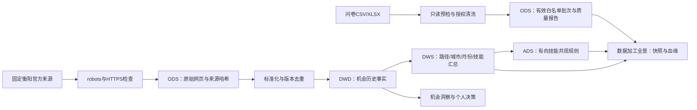

# V0.3 功能审查、数据接入与业务验收指南

更新日期：2026-10-14。主应用继续在 Windows 本地运行，数据库使用本地 MySQL；云端 SQLite 仅用于开发验证。该版本完成可运行链路的审查与优化，尚不代表已完成真实推荐效果或心理测量效度实验。

## 一、本次要求与交付

| 要求 | 实际交付 | 页面入口 |
| --- | --- | --- |
| 功能完整、流程清晰 | 个人状态、五步路线、缺失条件提示、历史与行动闭环 | 首页 → 使用路线；辅助决策 |
| 插入附件数据 | 13 所高校、31 个专业、5 个学科原始汇总；保留来源与差异 | 学校概况 |
| 问卷文件导入 | CSV / XLSX 文件向导、列对应、只读预检、确认导入、质量报告 | 管理员 → 问卷导入 |
| 展示采集 / 清洗 / 挖掘 / 仓库 | 实际运行记录、质量计数、分层存储、事务刷新、技能共现与血缘 | 管理员 → 数据加工全景 |
| 优化决策业务 | 目标与准备检查、权重预设、路径内比较、敏感性分析、两周行动与复盘 | 辅助决策 |

## 二、更新与启动

下载仓库最新源码并更新项目文件。先停止旧的前后端，保留自己电脑上的 `backend/.env`、虚拟环境和 MySQL 数据库，不删除数据库。

在 `E:\my_master_DT_workpace\stan-main` 的 PowerShell 执行一次升级：

```powershell
powershell -ExecutionPolicy Bypass -File .\scripts\setup-local.ps1 -Demo
powershell -ExecutionPolicy Bypass -File .\scripts\start-local.ps1
```

升级会执行 Alembic `0004`、`0005`，载入附件数据，并为模拟机会生成仓库与挖掘结果。重复运行不会重复插入高校、专业或机会事实；运行批次与刷新任务仍保留审计记录。已有账户、画像与历史记录保留。

此后日常只需运行 `start-local.ps1`。MySQL 服务须运行；在启动窗口按 Enter 停止本次前后端。真实管理员可用 `python -m app.cli create-admin` 创建；`-Demo` 创建的公开演示账号见仓库 README。

## 三、学生业务流程


“使用路线”显示当前画像版本、是否有兴趣记录、当前公开 / 模拟范围内最近的比较，以及已完成行动数量。没有画像时，辅助决策明确引导先填写；未做兴趣问卷也能比较。学校资料与职业资格没有自动等同关系。

“辅助决策”按就业、升学、公务员、事业单位、实习分别整理线索，不把不同人生路径合成一个优劣分数。默认最多检查 100 条最新机会，展示最多 6 项；需要完整覆盖时先通过机会检索缩小范围。未知技能、城市或专业条件不按零分处理，明确条件不符项不参与评分。

敏感性分析固定本次已展示的机会和条件，分别使用本次、均衡、技能优先、城市优先四组权重重新计算。相同分数并列；只在同路径内显示名次。不足两个可评分对象或有效维度不足时，不宣称排序稳定。结果与当时画像和机会版本一起保存，行动更新不重算历史依据。

## 四、附件数据的插入与口径

原文件：`高校教职工与专业数据导出.docx`。来源自述为本地 MySQL `hengyang_campus` 的 `t_university`、`t_university_major`；原文导出时间为 `2026-10-14 11:44:01`，无时区及统计年份。工程将表格逐项转为 `data/school-export-20261014.json`，记录原文件 SHA-256、规范化载荷 SHA-256、原始值与校验结果。

| 核对项 | 结果 |
| --- | --- |
| 高校 | 13 所，原文在校学生合计 175,100，教职工合计 12,450 |
| 专业 | 湖南交通工程学院 31 个专业，在读人数合计 12,440 |
| 学科 | 工学 18 / 8,000；管理学 8 / 2,810；医学 2 / 1,010；经济学 2 / 420；文学 1 / 200（专业数 / 人数） |
| 人数差异 | 学校概况 12,000 与专业合计 12,440 相差 440；可能涉及取整或时点差异，原文未提供足够依据，两值都保留 |
| 就业率 | 31 项原值保留，缺少毕业届次、观察日、定义、人数分母，只在复核区域展示，不计算就业人数、平均就业率或推荐分 |

学校页面支持按区域、办学类型、校名筛选，最多三所对照；专业按学科、层次、名称筛选，有柱状图、环图与明细表。高校和专业筛选相互独立，专业仅来自交通工程学院。人数占比以 12,440 为分母，不能混用学校概况人数。“重点建设”只解释为附件整理重点，不当作官方高校认定。

持久化表：`raw_school_dataset`（来源版本）、`dim_university_snapshot`（每来源每高校）、`fact_university_major_snapshot`（每来源每专业层次）。相同原文件哈希重复加载直接跳过；同一原文件哈希下内容被更改会拒绝，避免悄悄篡改来源。

## 五、问卷导入向导

1. 从问卷星或腾讯问卷导出逐条答卷，第一行为列标题；使用 CSV（UTF-8 / GB18030）或 XLSX（第一张可见表）。也可下载页面的模拟模板练习。
2. 输入明确的问卷来源名称，选择模拟或真实授权。对应答卷编号、本人同意列及全部 30 道题；其他字段可选。额外非个人信息列需明确确认忽略。
3. 核对题目与五级喜欢程度选项与本平台相同。不能把任意满意度、心理问卷自动当作职业兴趣测量。单条回答可为空，未知不补成中间分。
4. 点击预检：看到可导入、重复、拒绝计数及行号；此时不保存文件、答卷或批次。
5. 确认导入：重新验证并保存有效授权行。拒绝和无授权行只保留错误码与行号，不保存原始答案；相同答卷跳过，同键不同答案拒绝覆盖。
6. 在数据加工全景查看批次与清洗结果。外部答卷不自动绑定站内学生，也不会改写登录学生的私人兴趣伙伴。

CSV 原文件、转换后 CSV 与规范化载荷分别受 500 KB 上限约束；XLSX 原文件最多 1 MB、展开最多 5 MB，每批最多 1000 条、100 列。不执行公式、宏或外部链接。姓名、手机号、邮箱、学号、IP 等列排除；预览不回显任意未映射原始值。文件或字段对应变化后必须重新预检。

| API（均须管理员） | 用途 |
| --- | --- |
| `POST /api/admin/surveys/file/inspect` | `{filename, content_base64}`，返回结构、可映射列与建议 |
| `POST /api/admin/surveys/preview` | 文件、来源、类型、授权、问卷版本、列对应、忽略列；只读清洗报告 |
| `POST /api/admin/surveys/commit` | 同样请求加 `preview_fingerprint`；重新校验，保存质量报告 |

原 JSON / CSV 批量接口继续保留，便于外部系统服务端接入；其记录和大小契约见 [V0.2 指南](FEATURES_V2.md)。

## 六、采集、清洗、仓库与挖掘



该版本为 **MySQL 关系型分层仓库原型**。DWS 与 ADS 是实际落表的计算结果；不是 Hadoop / Hive / Spark 集群。当前学生图表与决策仍读取最新机会事实，本页汇总需要显式刷新，来源更新后显示“快照过期”。问卷原始答案、个人画像和逐人去向不参与公告技能共现。

| 层 | 实际表 | 粒度 |
| --- | --- | --- |
| ODS | `raw_crawl_document`、`ingestion_batch`、`raw_school_dataset` | 一张网页快照 / 一次清洗批次 / 一份学校来源 |
| DWD / 维度 | `fact_opportunity_snapshot`、高校与专业快照 | 一个来源记录的一个版本；来源数据类型分开 |
| DWS | `dws_opportunity_summary` | 每种公开 / 模拟范围一份物化汇总，含各维度 JSON 单元 |
| ADS | `ads_skill_association` | 每范围每有向技能组合一条达标规则 |
| 运行记录 | `pipeline_refresh_run` | 一次计算的输入数、汇总单元数、规则数、指纹与时间 |

技能挖掘使用二项频繁项集：同义技能标准化、单条公告技能去重；至少 5 条最新公告、组合至少出现 3 次，最多保存 100 条有向规则。支持度 = 同时出现 A、B 的公告数 / 本范围全部最新公告数；置信度 A→B = 同时出现 A、B 的公告数 / 出现 A 的公告数。技能未知公告仍在支持度分母中。双向置信度一般不同；这不是因果关系或录用概率。统计含过期公告，描述收集样本，不当作当前可报名岗位人数。

`GET /api/admin/data-pipeline?data_kind=demo|public` 展示处理结果；`POST /api/admin/data-pipeline/refresh?data_kind=demo|public` 在同一事务替换 DWS/ADS。输入未变化时保留一份物化结果、追加“来源无变化”任务。中途失败整笔回滚，历史任务和原结果保留。血缘含输入机会 ID、关联原文 ID、指纹、清洗版本、输出表及刷新时间。

2026-10-14 在当前云机器实际调用采集接口：衡阳栏目返回 **HTTP 412**，任务为 `blocked`，真实新增 0。系统没有绕过限制；来源可正常访问后仍需遵循 robots 与官方要求，采集结果以运行记录为准。此前 2026-10-13 的出站代理 403 是历史验证结果。离线模拟素材保留 `demo` 与虚构来源标记。

## 七、决策网站的业务参考

业务参考入口包括 [My Next Move](https://www.mynextmove.org/)、[CareerOneStop](https://www.careeronestop.org/ExploreCareers/explore-careers.aspx)、[英国 National Careers Service](https://nationalcareers.service.gov.uk/explore-careers)。本次云请求这三个站点均被出站代理 403 阻止，未能实时浏览或逐页审查其当前实现，不宣称完成实时竞品测评。

采用职业探索服务常见的“认识自己 → 探索职业信息 → 比较条件与取舍 → 制定行动”的业务结构，映射到本系统的画像、兴趣、机会、决策与行动；不复制品牌、界面资产、职业数据库或心理测评题目。具体改进是可选兴趣步骤、明确缺失证据、同路径比较、偏好变化分析与第 14 天复盘，避免只给学生一个难以解释的最终分数。

## 八、验收与剩余边界

自动化验证、运行版本与实际结果见 [验证记录](VALIDATION.md)。建议答辩演示依次：学生使用路线 → 高校来源及人数差异 → 画像与伙伴 → 多维机会图表 → 权重敏感性与行动 → 管理员问卷向导 → 清洗质量与分层仓库 → 技能规则及血缘 → 官网受限记录。

本次不包含学校统一身份认证、官方核实的学校就业率、全部招聘附件解析、真实数据上的推荐效果实验、问卷心理测量效度研究、TF-IDF 对照、Parquet/PySpark 性能实验，以及完整分布式仓库。测试说明功能链路按断言运行，不能据此保证所有真实网站模板和任意外部问卷都兼容。
