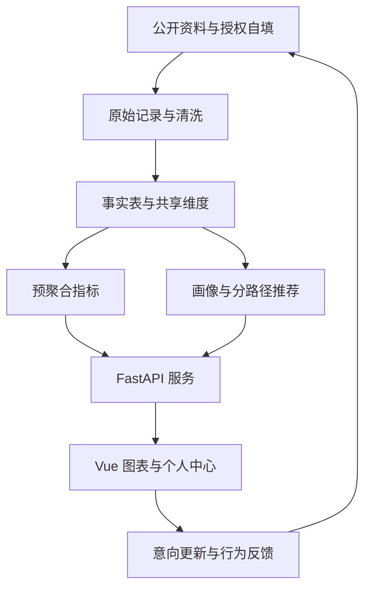

# 毕业设计实施方案：学生职业发展辅助决策平台

研究对象：湖南交通工程学院学生。规划日期：2026年10月11日。本方案围绕数据科学与大数据技术的课程能力设计，起步代码采用前后端分离。

## 1. 选题建议与研究边界

建议题目：**基于多源数据仓库与动态用户画像的大学生职业发展辅助决策平台设计与实现——以湖南交通工程学院为例。**

核心业务是让学生了解同专业历史去向、表达自己的多种发展意向、比较可用机会和技能差距。用户无需先决定“就业还是考研”，可以同时准备多种路径。

数据主线：公开资料与授权自填数据 → 原始数据保留 → 数据清洗与标准字典 → 主题数据仓库 → 学生画像与推荐 → 仪表盘与效果验证。

毕业设计必须证明三个问题：数据从哪里来且如何统一；历史画像和去向如何正确统计；推荐为什么产生且如何评价。页面数量、框架数量和模拟数据量不应替代这三个问题。

## 2. 已查阅的可借鉴案例

| 文献/已实现案例 | 可核实信息 | 本项目借鉴方式 |
|---|---|---|
| 崔秀艳，2023，《基于大数据分析与人工智能的智慧就业推荐系统设计与实现》，河北软件职业技术学院学报，25(2):15–19，DOI:10.13314/j.cnki.jhbsi.2023.02.015 | 期刊页面摘要描述学生画像、混合推荐及Django+Vue Web系统。此次阅读范围为期刊公开摘要，没有阅读全文和实验数据。 | 采用“画像—匹配—职业能力分析—就业资讯”的业务结构，扩展到多路径选择。 |
| Qin等，2018，Enhancing Person-Job Fit for Talent Recruitment: An Ability-aware Neural Network Approach，arXiv:1812.08947 | 原作者论文介绍能力感知人岗匹配及对比实验；属于SIGIR 2018相关论文的扩展版本。 | 将岗位要求与学生技能逐项匹配，输出解释和不足；本科第一版不复现复杂神经网络。 |
| Han等，2024，Adapting Job Recommendations to User Preference Drift with Behavioral-Semantic Fusion Learning，arXiv:2407.00082，KDD 2024 | 原作者论文讨论求职偏好变化，并报告离线与线上实验。 | 让画像保留历史版本，比较偏好改变前后的推荐，作为时间建模的启发。 |

这些是已发表的研究与实现案例，不能据此声称某份网络本科毕设已通过答辩。它们用于验证技术路线可参考，不构成本项目真实数据和效果的证据。

## 3. 功能与优先级

| 页面/角色 | 必做内容 | 后续扩展 |
|---|---|---|
| 登录后首页 | 同专业去向、目的城市、画像概览、近期机会、届次/专业筛选、样本量与来源日期 | 意向和去向差异、地域比较 |
| 学校概况 | 学院/专业目录、公开师资与办学规模指标、历年变化、报告来源 | 与其他院校同口径比较 |
| 个人中心 | 私人基本信息、结构化简历、技能、英语与实习、多个城市与路径、画像版本 | 简历文件上传与自动抽取 |
| 机会资讯 | 企业/实习、考研、公务员、事业单位分别展示；条件筛选；截止日期；原文链接 | 收藏、明确的报名/投递反馈 |
| 校友经验 | 用户授权的公开昵称、毕业届次、城市/院校/单位经验、管理员审核 | 讨论区、经验检索 |
| 管理与数据工作台 | 来源配置、数据导入、质量报告、字典维护、聚合指标、角色权限 | 增量任务和更完整的模型监测 |

“资讯招聘”建议改名“机会资讯”或“发展机会”，因为考研不是招聘。小论坛先做经验帖、评论、举报和审核，不做即时聊天、好友关系和复杂社交功能。衣食住行可作为学校概况的次级导航，主项目应优先完成与职业选择有关的数据链路。

## 4. 首页应该如何展示

推荐双入口：公开访问时给出学校基本信息和公开统计；学生登录后进入与本人专业和毕业届次有关的发展总览。学校概况始终作为独立导航可进入。

你提供的截图可以作为学校概况的视觉参考。它包含办学规模、专业构成、学科门类及专业规模与就业指标的比较。使用时应改进：

- 给每个图标注年份、指标定义、样本范围和来源。截图中的数字目前没有经过来源核验。
- 教职工与专任教师不能混用；在校学生与当年毕业生不能混用；“就业率”和“毕业去向落实率”也不应直接替换名称。
- 在校学生与教师人数用两个图或直接标明双坐标轴；不同统计口径学校的排名不应直接比较。
- 多专业饼图会很拥挤，优先用可排序横向条形图；气泡图设置专业筛选与悬停标签。
- “专业规模×就业指标”只能描述关联，不能据此推出规模导致就业率变化。

登录后首页的建议内容：顶部显示专业/毕业届次筛选与“完善画像”；第一行显示有来源的学校摘要、当前统计样本量和更新时间；中部展示去向分布、城市分布与历年趋势；下方展示匹配机会、技能差距与经审核的校友经验。空数据应显示“暂无已核实数据”，不要补成零或假统计。

## 5. 职业路径分类必须分成不同轴

| 维度 | 示例 |
|---|---|
| 当前阶段 | 在校、准备实习、求职中、备考中、已毕业 |
| 当前意向（多选） | 企业就业、升学、考公务员、考事业单位、实习 |
| 单位性质 | 国企、民企、政府机关、事业单位、其他 |
| 实际毕业去向（某个观察日） | 企业就业、升学、公务员、事业单位、待落实、其他 |
| 目的城市 | 就业城市或升学院校城市 |
| 目标实体 | 岗位、研究生招生专业/项目、公务员职位、事业单位岗位 |

国企属于单位性质，不能和“考研、考公”作为互斥类别混排；实习属于发展阶段/机会类型，不应直接当成毕业后的最终就业结果。一个学生可同时有多个意向，但在同一统计观察日应按既定口径记录主要实际去向；更晚转向需产生新的观察日快照。

学生写“准备考研”不代表已经升学。简历意向统计、报名行为和确认的毕业去向必须分别建表。正式数据若含灵活就业、自主创业等类别，应扩展标准维表，并保留未知/其他，不强制归入就业。

## 6. 数据从哪里获取

| 数据 | 起始公开入口/获取方式 | 用途与限制 |
|---|---|---|
| 学校与专业公开资料 | https://hnjt.edu.cn/；https://hnjt.edu.cn/list/22.html；https://hnjt.edu.cn/show/1079.html | 学校概况、专业目录、专业培养能力标签。专业官网名称为“数据科学与大数据技术”。 |
| 本科教学质量报告 | 2023—2024学年入口：https://hnjt.edu.cn/show/22091.html；2022—2023年PDF：https://hnjt.edu.cn/upfile/2023/12/1701749366977.pdf | 可尝试提取师资、学生规模、专业结构和发布的相关指标；近期正文此次访问不稳定，不能声称已经抽取全部表格。 |
| 学校就业报告 | 已查到2017年公开PDF：https://hnjt.edu.cn/upfile/201801/2018011241173777.pdf；近期报告向学校就业部门进一步确认 | 旧报告可用于学习字段和版式，不应用作当前学生的市场结论。此次没有取得近期逐人校友去向库。 |
| 衡阳招聘/事业单位公告 | https://www.hengyang.gov.cn/hysrsj/ywgz/sydwgkzp/index.html | 公告、职位附件、报名时间与专业学历条件。网站此次直接访问返回限制，但搜索索引能确认栏目。 |
| 湖南公务员信息 | https://rst.hunan.gov.cn/rst/hnrsksw/c103103/gwy2026/rskswlist.html | 使用正式公告与附件，区分应届招考、遴选等适用对象。年度切换时更新来源配置。 |
| 考研信息 | https://yz.chsi.com.cn/；目标高校研究生招生官网 | 院校/项目、考试科目、招生条件、原文。信息缺项时标“待核对”。 |
| 就业机会扩展 | https://www.ncss.cn/；企业招聘官网及学校公开校园招聘公告 | 优先公开读取/允许导出的资料，按来源规则配置采集；不要依赖绕过登录的平台。 |
| 学生画像 | 本站结构化表单、问卷，自愿填写 | 专业、技能、英语、实习、城市及多路径意向；隐私信息默认仅本人可见。 |
| 校友逐人去向/经验 | 校友授权自填；学校授权匿名CSV/Excel | 才能做同专业校友匹配、历史去向和经验展示；明确自报/学校确认状态。 |

学校公开报告一般是汇总粒度，不能还原逐人简历。报告的100人和本站采集的20个样本可能包含同一批人，不能相加成为120人。也不能将报告百分比转换成虚构个人后训练“真实”模型。

起步阶段先聚焦一个专业、2–3个毕业届次和湖南/衡阳公开机会。先收集两个来源各10条公告，手工检查字段后再写采集器。真实样本数量根据授权与回收情况报告，不预先承诺全校完整数据。50–100份真实自愿问卷可以作为可行性研究的起点，但不能保证模型泛化；不足时以数据治理和辅助推荐为研究重点。

## 7. 采集与清洗流程

每条记录保存source_url、published_at、fetched_at、source_record_id、content_hash、batch_id。不同来源页面和附件使用各自解析规则，遵循公开访问规则和合理频率，不绕过身份验证。

先落原始HTML/PDF/CSV，保留版本；再规范城市、专业、职业和单位名称；再进行类型与日期检查、字段缺失标记、去重和业务约束检查；最后入事实表、维度表和聚合表。

典型清洗问题：

1. “长沙市/长沙”对应同一城市；县区映射地级市需要正式维表，不能一概删除最后一个字。
2. “护理”与“护理学”可能是不同教育层次专业，不能只凭名字相似合并。
3. 公告标题相似不代表同一岗位；组合使用单位、职位编号、招聘批次和原文ID。
4. 截止时间缺失标未知，过期公告保留历史但退出当前推荐。
5. 工资有月薪、年薪、范围、税前和面议，不能直接求平均；缺失不是0元。
6. 英语能力未填写表示未知，不能等价于没过四级；自报技能和经证明技能分别标来源。
7. 重跑任务不重复计数，重复主键和不一致记录进入拒绝/待审区。
8. PDF表格抽取后用抽样人工核对；截图/OCR值尤其要检查列错位、百分号和页码。

质量报告输出完整率、类型/范围通过率、重复率、解析正确率抽样结果和接受/拒绝记录数。不要只展示“清洗完成”。

## 8. 数据库与数据仓库设计

本科起点建议一个PostgreSQL实例内分业务schema和分析schema；数据量增长后再评估是否拆独立存储。业务表保存登录、简历和发帖事务，分析表服务画像、历史统计和多维钻取。

分层建议：ODS原始记录 → DWD规范化明细 → DWS主题汇总 → ADS仪表盘/推荐服务。DWD/DWS可以是任务输出和逻辑层，不必为了展示层数安装四套系统。

| 类别 | 核心表/实体 | 粒度或用途 |
|---|---|---|
| 业务 | user、identity_verification、resume_snapshot | 用户、身份核验与简历版本 |
| 业务 | resume_skill、career_intent、preferred_city | 技能、多路径与多城市，使用关联表 |
| 业务 | opportunity、employment_detail、exam_detail、postgraduate_detail | 统一基础机会表，各路径保留自己的资格条件 |
| 业务 | alumni_outcome、experience_post、comment、interaction_event | 授权实际去向、公开经验与行为 |
| ODS/元数据 | raw_document、ingestion_batch、quality_result、name_alias | 原始载荷、来源、任务、清洗版本与字典 |
| 维度 | school、major、city、date、path、organization、skill | 一致性维度，支持跨来源统计 |
| 时变维度 | dim_student_profile | SCD2画像历史，含profile_sk、student_key、版本与有效期 |
| 桥接表 | bridge_profile_intent / city / skill | 一个画像的多个意向、城市和技能 |
| 事实 | fact_intent_snapshot | 一名学生一天的一次意向/画像快照 |
| 事实 | fact_outcome_snapshot | 一名匿名毕业生、一个届次、一个观察日、一种来源的主要实际去向 |
| 事实 | fact_opportunity_snapshot | 一个机会的一个有效版本 |
| 事实 | fact_report_metric | 一份公开报告、一个范围、一个口径的汇总指标 |
| 事实 | fact_recommendation_exposure、fact_interaction | 当时推荐列表曝光与后续用户行为 |
| ADS | major_outcome_distribution、city_skill_demand、recommendation_result | 看板预聚合与保存的推荐结果 |

重要字段：画像历史用valid_from、valid_to、recorded_at；推荐保存profile_version、opportunity_version、model_version和generated_at；公开指标保存统计年份、分母、单位和定义版本。只有有可靠授权身份映射时，才能把个人早期意向与其毕业去向关联比较。

### 值得做成论文重点的三个改进

**多源、多粒度统一。** 用共享专业/城市/技能字典处理来源差异，同时分开存公开报告指标和逐人记录，避免粒度错误与重复计数。展示一条图表指标能追溯到哪个文件、哪次任务、哪个清洗版本。

**时变画像与可重现推荐。** 例如学生9月偏向考研、11月同时找工作，保存新版本而不覆盖旧版本；历史推荐引用当时画像和当时机会。比较最新画像覆盖法与历史版本法是否会改变对往届行为的解释。SCD2是现有方法，本项目的贡献在于适配业务、实现和验证。

**面向分析的查询优化。** 将高频的专业/届次/去向查询从业务多表查询改成仓库事实查询与ADS预聚合；对日期和专业建立适当索引，数据量足够时再做时间分区。比较查询正确性、P50/P95延时、加载成本和数据新鲜度。不能预先承诺10倍提速，也不必一开始搭建Hadoop、Hive、Kafka和Flink全套。

## 9. 模型方案：先可解释基线，再做有条件的提升

### 9.1 用户画像

核心标签：专业/年级、技能、英语、实习、职业/城市/单位性质偏好，以及可证明的项目经历。区分用户自报、证书/经历支持和模型推断的标签。雷达图只有有一致可解释量表时使用；单凭简历不能画“沟通能力90分”。

### 9.2 推荐

先按发展路径分组，再筛除已明确不满足硬条件或已过期的机会。考公、事业单位和研究生专业条件复杂，字段缺失或专业目录匹配未核实时标“需要核对”，不能自动认定有资格。

企业岗位的第一版可用结构化技能重合、城市偏好和专业条件组成排序分：

`S(u,j) = [0.50·K(u,j) + 0.30·C(u,j) + 0.20·M(u,j)] / 已观测项权重之和`

这里K为所列要求技能的覆盖比例，C为城市偏好是否匹配，M为已结构化专业条件是否匹配。未知字段不当成0，信息太少时只展示专业相关与近期机会，不生成貌似精确的分数。权重只是待验证的起始值，不是数学定理或录用概率；分别调整权重做敏感性分析。

第二版：以中文分词/标准技能词典构造文本，TF-IDF＋余弦相似度作为可复现的内容推荐对照；第三版在真实数据充足时试预训练文本向量＋结构化约束，并和TF-IDF比较。向量仅检索描述相似，不能替代资格判断。

考研方向、考公职位和企业岗位的标准不同，应分别定义指标与候选集合，不把三个分数相加给学生一个唯一人生选择。初期没有足够交互数据时，不优先做纯协同过滤；没有历史招生/考试与结果标签时，不展示“上岸概率”。

### 9.3 相似校友与群体分析

只在有授权逐人匿名数据时，按同专业、毕业届次、技能/经历等可观测特征寻找参考校友。混合数值/类别特征可考虑Gower距离；只有标准化的数值向量时才直接考虑K-means。类簇以可观察特征命名，不给学生贴“低就业能力”标签。

校友案例具有自愿填报和成功经历偏差。页面同时标样本量与年份，不把样本去向比例当成个人成功概率。关联规则需要报告支持度、置信度、提升度和最小样本数；小样本不支持大量职业因果解释。

### 9.4 预测与深度学习的范围

少量年度就业比例不适合训练复杂时间序列预测。若拿到连续月度岗位数据、去重口径稳定且覆盖足够长，可先和简单移动平均/季节基线比较；否则只展示描述性趋势。深度学习可作为文本表示扩展，不应为覆盖课程强行训练网络。

## 10. 技术架构

| 层 | 推荐选择 | 理由 |
|---|---|---|
| 前端 | Vue 3、Vite、ECharts；完整版本补Vue Router/Pinia | 交互式图表、表单和前后端分离 |
| 后端 | Python FastAPI、Pydantic、SQLAlchemy；完整版本补Alembic | 便于数据处理/模型复用、字段验证与API联调 |
| 业务与仓库 | PostgreSQL；第一天可SQLite本地起步 | 事务、关系约束、schema、索引与物化视图 |
| 小规模ETL | Python CSV/pandas、SQL、来源专属解析器 | 容易调试并建立字段与质量规则 |
| 批处理 | PySpark、分区Parquet，按数据规模使用 | 展示批处理与可扩展的数据工程能力 |
| 模型 | scikit-learn，后续按需用预训练向量 | 保留可复现基线与真实评估 |
| 调度/部署 | 起初手工命令，之后定时任务；Docker Compose/Nginx | 先跑通，再增加自动化和部署 |

若导师要求Java后端，可选择Spring Boot做业务接口、Python做离线分析；第一版不建议同时维护两个业务后端。

架构关系：

## 11. 与所学课程的对应

| 课程 | 可展示的项目成果 |
|---|---|
| 大数据可视化技术 | 同专业去向、城市、技能需求、版本变化与交互筛选 |
| 数据仓库与数据挖掘 | 星型/星座模式、一致性维度、SCD2、主题汇总与可选关联分析 |
| 关系数据库原理 | 主外键、事务、索引、权限、迁移、并发版本检查 |
| 分布式大数据处理与应用 | PySpark批处理、分区Parquet、不同数据规模性能实验 |
| 应用统计学 | 描述统计、样本量/置信区间、抽样与缺失偏差分析 |
| 运筹学 | 多条件约束与多准则排序、权重敏感性分析；资源分配优化留作扩展 |
| 机器学习 | TF-IDF内容匹配、可解释排序、模型对照与评估 |
| 神经网络与深度学习 | 可选预训练文本向量；有可靠数据时与基线对比 |
| 领域大数据技术与应用 | 高校生涯指导场景与岗位/招生/招录数据融合 |
| 市场调查与预测 | 需求问卷、教师/学生评价、去重后的岗位趋势；预测视数据条件决定 |
| 大数据安全技术 | 角色权限、密码散列、匿名化、授权与可追溯访问 |

课程对应不是承诺每门课都实现独立模块；核心仍是数据仓库、数据工程、画像推荐和可视化。

## 12. 实验与论文证据

| 实验 | 设计 | 结果需报告 |
|---|---|---|
| 数据质量 | 人工核对分层抽样的公告字段与PDF表格，对比清洗前后 | 缺失率、重复率、解析准确率、拒绝数量及典型错误 |
| 推荐有效性 | 人工标注/真实反馈，比较热门基线、规则、TF-IDF和组合模型 | Precision@5、NDCG@5、候选覆盖率、分路径结果 |
| 推荐可信解释 | 学生与教师评价理由是否有依据、技能差距是否正确 | 问卷量表、评分分布、具体错误类型，不只报告满意度 |
| 历史一致性 | 保留不同版本，查询当时画像/机会；和覆盖旧版本方式对比 | 历史结果可重现率、错误回溯案例 |
| 查询性能 | 同一数据和硬件比较业务查询、DW查询、ADS预聚合 | P50/P95耗时、索引空间、刷新时间与结果一致性 |
| 批处理 | 合理的1万/10万/100万条模拟数据规模比较Python与Spark | 硬件、线程/分区、耗时、内存、数据量和启动成本 |

同一个人的不同画像不能随机分到训练与测试两边。推荐历史评价只用当时已存在的机会和画像；未来毕业结果和未来用户行为不能当输入。超参数/排序权重在验证集确定，测试集最终只评价一次。用按用户/时间的独立留出方案，并说明标签含义。

点击和收藏反映兴趣，不等于就业成功，也不等于适合程度。教师相关性标注应和行为指标分开报告。相同候选集合、过滤规则与数据划分下比较模型；对同一用户各模型结果可以做成对比较，样本允许时报告置信区间。

模拟数据只用于功能、数据约束和性能实验。真实推荐有效性需要真实授权样本及可信标注；数据不足时论文明确定位为原型/可行性验证，不编造准确率。小规模任务Spark可能比Python慢，应如实解释分布式启动成本。

论文结构可用：绪论与相关工作；需求与数据来源；数据库/仓库设计与数据治理；画像与推荐方法；系统实现；实验与结果；不足与展望。篇幅主要放数据设计、方法和评价。

## 13. 登录、实名与安全设计

后台账户和公开昵称分开；默认不公开完整简历与联系方式。学校SSO只有取得接口后才能接入。没有接口时用校内邀请码或教师审核，不能让学生输入真实教务密码到自建站，也不能将普通注册称为学校身份认证。

逐人去向在同意范围内使用，公开论坛经验单独授权。分析表使用受控匿名标识，与身份映射分离；密码使用成熟散列方案；学生只能读取/修改自己的画像，教师只看权限允许的聚合结果，管理员操作留记录。小组人数过少时隐藏并防止通过总数和比例反推；这不等价于完整匿名性证明。

允许用户纠正意向、撤回公开经验与申请删除其数据，并明确哪些历史聚合需要重算。非必要不采集身份证照片与完整家庭信息。

## 14. 实施顺序与第一周

| 周次 | 工作 | 可验收结果 |
|---|---|---|
| 第1周 | 与导师确认题目；列数据字典、授权与来源；启动起步工程 | 简历保存→清洗→去向统计→推荐全链路可演示 |
| 第2周 | 收集两个来源各10条真实公告与一批公开汇总指标，标注解析 | 原始记录、规范化字段、质量摘要、原文链接 |
| 第3–4周 | PostgreSQL正式业务表、事实表/维度表、画像历史 | 可按专业/届次/观察日钻取且不重复计数 |
| 第5周 | 学校概况、个人画像、机会页面与指标口径 | 真实数据与模拟/自报数据清楚分开 |
| 第6–7周 | 规则/TF-IDF对照、资格规则、评价样本 | 推荐理由、实验表、错误分析 |
| 第8周 | 校友授权经验帖、审核；按时间允许补论坛 | 帖子可发布、审核、显示和撤回 |
| 第9–10周 | 性能、数据质量与历史一致性实验；论文和答辩 | 可重现实验、技术文档、演示脚本 |

第一天应从“画像表＋往届去向CSV＋一个API＋一张图”开始。第一批真实数据还未获得时允许用带醒目标记的模拟数据跑通，但不要等全校数据齐全才开始写代码。

## 15. 当前附带起步工程的真实状态

`career-starter.zip`包含Vue/ECharts前端、FastAPI/SQLAlchemy后端、CSV导入器、规则推荐、画像历史、数据字典、正式仓库SQL蓝图和可选PySpark示例。它实现的是第一阶段链路，没有完成正式学校身份认证、近期真实校友数据库、自动公告采集、完整SCD2加载、论坛和模型效果实验。

起步数据库采用SQLite，后端16项测试已通过，前端生产构建通过，模拟导入180条记录无拒绝。Chromium页面操作检查通过首页图表、登录、画像保存、推荐刷新、学校来源链接和390px宽度布局，未发现页面JavaScript错误。PostgreSQL实库与PySpark运行尚未验证，不能把这两项写成已经完成的实验。具体启动命令与验收步骤在工程README.md。

## 16. 参考资料入口

1. 崔秀艳，2023，期刊公开摘要：https://hbzg.cbpt.cnki.net/portal/journal/portal/client/paper/65d67f125ee9e24f9376594b3f31f08f
2. APJFNN原作者论文：https://arxiv.org/abs/1812.08947
3. BISTRO原作者论文：https://arxiv.org/abs/2407.00082
4. Kimball的SCD2原始技术说明：https://www.kimballgroup.com/2008/09/slowly-changing-dimensions-part-2/
5. PostgreSQL物化视图官方文档：https://www.postgresql.org/docs/current/rules-materializedviews.html
6. FastAPI官方入门：https://fastapi.tiangolo.com/tutorial/
7. Vue官方起步：https://vuejs.org/guide/quick-start.html
8. scikit-learn TF-IDF官方说明：https://scikit-learn.org/stable/modules/generated/sklearn.feature_extraction.text.TfidfVectorizer.html
9. Spark Parquet官方说明：https://spark.apache.org/docs/latest/sql-data-sources-parquet.html

本方案中的权重、时间安排和模块优先级是针对本科实施难度提出的设计建议，不是文献已经证实的最优参数。所有真实统计数值和模型效果都应在取得数据并完成实验后填入。
